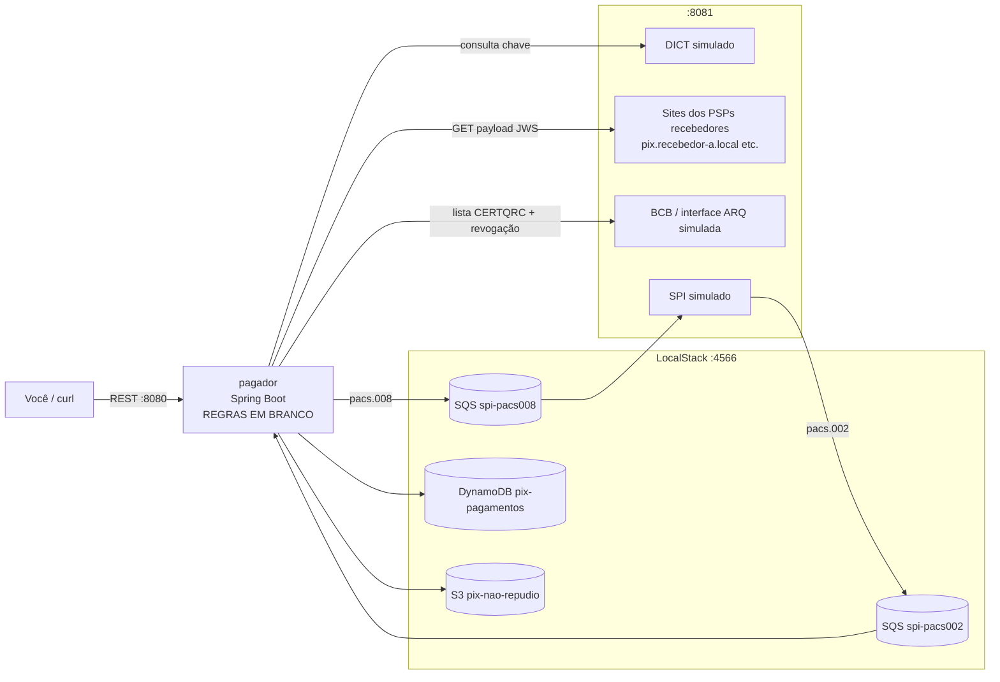

# Laboratório: pagamento de Pix por QR Code (lado do pagador PJ)

Um laboratório para **aprender, uma por uma, as regras que o PSP do pagador precisa cumprir** quando
uma empresa paga um Pix por QR Code (estático ou dinâmico), na hora ou agendado.

O sistema roda inteiro na sua máquina com Docker e [LocalStack](https://github.com/localstack/localstack)
(versão Community, gratuita): o "banco" pagador, o DICT, os sites dos PSPs recebedores (com payload
assinado em JWS), a lista de certificados do BCB e o SPI. Toda a infraestrutura está pronta.
**As 38 regras de negócio estão em branco**: cada uma é um método vazio, com Javadoc explicando a
norma e testes que funcionam como gabarito.

> Baseado nos documentos públicos do Banco Central do Brasil (versões de out/nov de 2026, ver
> [docs/FONTES.md](docs/FONTES.md)). Projeto de estudo: não é oficial, simplifica mensagens e
> infraestrutura, e não substitui a leitura do regulamento.

## Como funciona



## Rodando

Requisitos: Docker (com Compose). Para programar as regras: Java 21 e Maven.

```bash
docker compose up --build
```

Na primeira vez o build demora alguns minutos. Depois:

```bash
curl -s localhost:8081/simulador/qrcodes | python3 -m json.tool    # os QR Codes de teste
./scripts/ler.sh estatico-com-valor                                # lê um QR na conta empresa-a
```

Enquanto as regras estiverem em branco, a resposta será **HTTP 501** apontando a próxima regra a implementar:

```json
{
  "regra": "R01",
  "mensagem": "R01 ainda não implementada: RegrasLeituraQr.crcValido. Veja docs/REGRAS.md.",
  "proximoPasso": "Implemente a regra e rode: mvn -pl pagador test -Dtest='RegrasLeituraQrTest$R01*'"
}
```

Depois de mudar o código: `docker compose up --build pagador`.

### Rodando o pagador pelo IDE (para debugar)

Suba só a infraestrutura com `docker compose up localstack simuladores` e rode o `PagadorApplication`.
Os QR Codes dinâmicos apontam para nomes como `pix.recebedor-a.local`. Para eles resolverem na sua
máquina, adicione ao `/etc/hosts`:

```
127.0.0.1 pix.recebedor-a.local qrcode-h.recebedor-a.local pix.recebedor-revogado.local pix.nao-cadastrado.local pix.tls-antigo.local pix.wildcard.local pix.sem-ev.local
```

O `application.yml` já aponta para `localhost:8081` (simuladores) e `localhost:4566` (LocalStack).

## O caminho de estudo

1. **[docs/REGRAS.md](docs/REGRAS.md)**: as 38 regras na ordem do fluxo, em 7 marcos. A cada marco, um pedaço do sistema passa a funcionar.
2. **[docs/MAQUINA_DE_ESTADOS.md](docs/MAQUINA_DE_ESTADOS.md)**: as máquinas de estados (leitura, pagamento, agendamento) e os status da cobrança.
3. **[docs/CENARIOS.md](docs/CENARIOS.md)**: como provocar cada situação: fraude, certificado revogado, SPI que não responde, boleto pago antes do Pix agendado...
4. **[docs/FONTES.md](docs/FONTES.md)**: os documentos do BCB usados e o que o laboratório simplifica.

```bash
mvn -pl pagador test                                       # todas as regras (vão falhar até você implementar)
mvn -pl pagador test -Dtest='RegrasCobrancaTest$R16*'      # só uma regra
```

## Estrutura

```
pagador/                         o PSP do pagador (é aqui que você trabalha)
  regras/                        <- AS REGRAS EM BRANCO (R01 a R38)
  fluxo/                         orquestração: leitura, pagamento, agendamento (pronto)
  infra/                         DICT, recebedor, JWS, SQS, DynamoDB, S3, relógio (pronto)
  api/                           REST da "tela" e da simulação (pronto)
  test/.../regras/               o gabarito de cada regra
simuladores/                     DICT, PSPs recebedores, BCB (CERTQRC) e SPI (pronto)
localstack/init/ready.d/         cria filas, tabela e bucket
docs/                            roteiro, máquinas de estados, cenários e fontes
```

## Licença

MIT. Veja [LICENSE](LICENSE).
