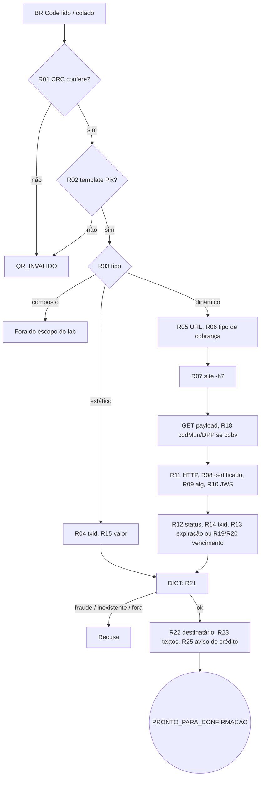
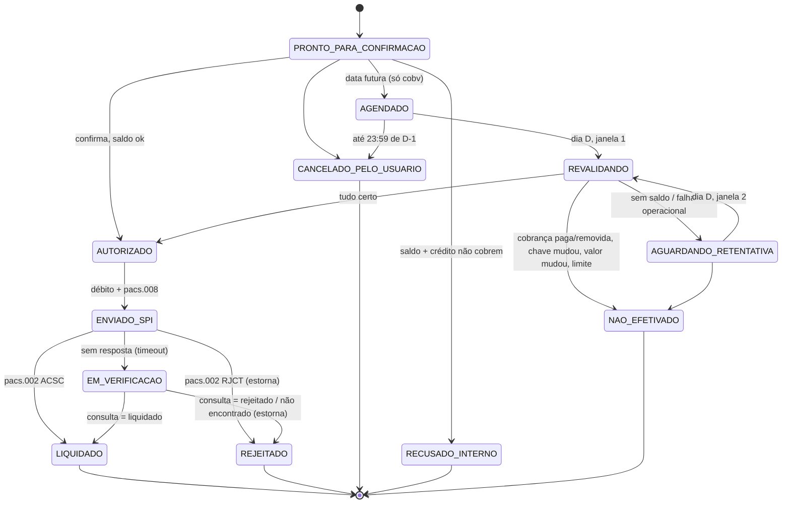
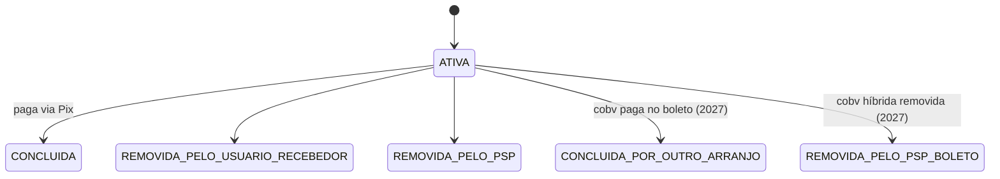

# Máquinas de estados do pagador

> O BCB **não define** estados internos do PSP pagador. Ele define regras: o que mostrar, quando
> recusar, quando notificar, e os status da cobrança. As máquinas abaixo são um **desenho** para
> cumprir essas regras. A tabela de transições é a regra **R26** (`RegrasPagamento.transicaoPermitida`).

## M1: leitura do QR (`FluxoLeitura`, `LeitorDePayload`)

A leitura não cria estado até dar certo. Qualquer recusa no caminho volta como HTTP 422, com o código e a mensagem que o pagador vê.

## M2 e M3: do "Pagar" ao fim (tabela da regra R26)

Por que existe cada estado "do meio":

- **EM_VERIFICACAO**: impede pagar duas vezes. Uma ordem sem resposta pode ter liquidado. A regra R29 manda **consultar**, nunca reenviar.
- **REVALIDANDO**: o agendamento foi feito dias antes. No dia D, a cobrança pode ter sido paga no boleto (cobrança híbrida, a partir de 01/02/2027), a chave pode ter mudado de dono e o recebedor pode ter mudado o valor. É a regra R34.
- **AGUARDANDO_RETENTATIVA**: o UX exige uma nova tentativa no mesmo dia quando falta saldo, com aviso ao cliente do horário limite. Regras R35 e R36.

## Status da cobrança (definidos pelo BCB, só `ATIVA` paga: regra R12)

A v2.10 do manual escreve `REMOVIDO_...` (masculino); a 2.11-rc, `REMOVIDA_...`. O pagador não precisa distinguir: tudo que não é `ATIVA` não paga. A URL também pode responder 404 ou 410 para cobrança encerrada (regra R11).
